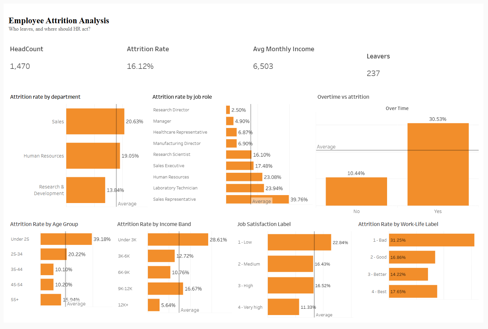

# Employee Attrition Analysis (Tableau)
Tableau dashboard analyzing employee attrition drivers using the IBM HR Analytics dataset
## Business question - Who is leaving, why, and where should HR act first?
## Dashboard
**Live dashboard:** <https://public.tableau.com/views/HRAttritionAnalysis_17938911080040/Dashboard1?:language=en-GB&publish=yes&:sid=&:redirect=auth&:display_count=n&:origin=viz_share_link>

## Data
IBM HR Analytics Employee Attrition & Performance dataset (Kaggle), 1,470 employees and 35 fields.
This is a public, fictional dataset. Source: <(https://www.kaggle.com/datasets/pavansubhasht/ibm-hr-analytics-attrition-dataset)>
## Tools
Tableau Public, calculated fields, interactive filters.
## Approach
- Hid constant columns (Employee Count, Standard Hours, Over18).
- Created Attrition Flag, Attrition Rate, Headcount and Leavers measures.
- Grouped Age, Monthly Income into bands, and labelled coded satisfaction and work-life scores.
- Compared attrition rate across department, job role, overtime, age, income, job satisfaction and
  work-life balance, with the company average (16.1%) as a reference line.
  ## Key findings
1. **Overall attrition is 16.1%** (237 of 1,470 employees).
2. **Overtime is the strongest signal:** 30.5% attrition for employees working overtime
   versus 10.4% for those who don't, about 3 times as high.
3. **Role and department:** Sales Representatives (39.8%), Laboratory Technicians (23.9%) and HR
   roles (23.1%) have the highest attrition. Sales has the highest department rate (20.6%).
   Small groups such as HR should be read with caution.
4. **Early-career and lower-paid employees leave most:** Under-25s leave at 39.2% and
   employees earning under 3K at 28.6%, versus 5.6% for those earning 12K+.
5. **Satisfaction:** low job satisfaction (22.8%) and poor work-life balance (31.3%) go with
   higher attrition, though the pattern is not linear across all levels.
   ## Recommendations
- Review workload and overtime policies, starting with Sales Representatives and Laboratory Technicians.
- Strengthen early-career retention (onboarding, mentoring, pay progression for lower bands).
- Run pulse surveys on work-life balance and act on the lowest scores.
## Limitations
- This shows association, not cause. Role, age, pay and overtime overlap, and this analysis did not
  separate their effects.
- Some groups are small, so their percentages are less reliable.
- The dataset is fictional, so results illustrate the method.
  

